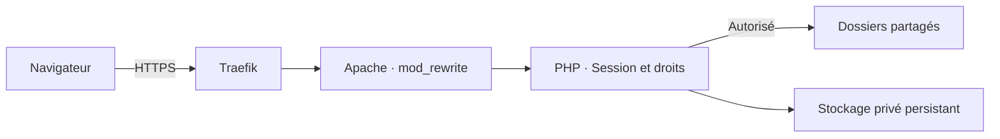

<div align="center">

# FileKeep for h5ai

**Un explorateur de fichiers en thème sombre, avec comptes utilisateurs, droits par dossier et journaux de sécurité.**


[Fonctionnalités](#fonctionnalités) · [Installation](#installation) · [Configuration](#configuration) · [Dépannage](#dépannage)

</div>

---

Cette version personnalisée de **h5ai 0.30.0** transforme un partage de fichiers
Apache en espace privé. Chaque utilisateur se connecte à son compte et consulte
uniquement les dossiers qui lui ont été attribués. Les administrateurs gèrent
les comptes et consultent l'historique depuis l'interface web.

Le déploiement présenté ici réutilise **un service PHP/Apache existant**, placé
derrière **Traefik**. Il ne nécessite ni base SQL, ni Composer, ni compilation du
frontend pour fonctionner.

> **À savoir avant l'installation**
>
> La protection des liens directs dépend du virtual host fourni. Installer
> uniquement les pages de connexion PHP ne protège pas les fichiers qu'Apache
> pourrait servir directement. La configuration fournie prend en charge tout
> `/var/www/html` et ignore les `.htaccess` des dossiers partagés.

## Fonctionnalités

| Fonction | Description |
| --- | --- |
| **Connexion privée** | Sessions PHP, déconnexion et option « Rester connecté » |
| **Administration** | Création de comptes, rôles, suppression et réinitialisation des mots de passe |
| **Première connexion** | Mot de passe temporaire généré, à remplacer avant tout accès aux fichiers |
| **Droits par dossier** | Autorisation d'un dossier entier ou de sous-dossiers précis |
| **Mon compte** | Modification de l'identifiant, du mot de passe et de la photo de profil |
| **Recadrage de photo** | Déplacement, zoom et aperçu rond ; export en 512 × 512 pixels |
| **Journaux** | Historique filtrable des connexions, changements et accès refusés |
| **Navigation** | Interface sombre, recherche configurable, aperçus et archives selon les options h5ai |
| **Médias** | Téléchargements et lecture partielle des fichiers avec prise en charge des requêtes HTTP Range |

### Les pages

| Adresse | Accès |
| --- | --- |
| `/` | Connexion, puis liste des fichiers autorisés |
| `/mon-compte` | Utilisateur connecté |
| `/administration` | Administrateur |
| `/journaux` | Administrateur |

Les anciennes adresses `/_h5ai/public/index.php`, avec ou sans paramètres,
et `/_h5ai/public/` répondent **404**, sans redirection. Les ressources CSS,
JavaScript et images restent chargées depuis leur emplacement interne.
Les routes applicatives sont réservées à la racine du partage.

## Fonctionnement



Apache réécrit les demandes de pages et de documents vers la passerelle PHP.
Celle-ci vérifie la connexion et les droits avant d'afficher un dossier ou de
transmettre un fichier. Les ressources visuelles de l'application sont publiques ;
les miniatures de documents restent protégées.

## Prérequis

- Un serveur Linux avec Docker et Docker Compose.
- Un service Apache compatible avec l'[image PHP officielle](https://github.com/docker-library/docs/blob/master/php/README.md) `php:…-apache`, disposant
  des commandes `a2enmod`, `apache2ctl` et `apache2-foreground`.
- Traefik déjà configuré pour votre domaine et HTTPS.
- Un réseau Docker partagé entre Traefik et Apache.
- Des dossiers persistants sur l'hôte pour les documents et les comptes.

Le code d'authentification impose PHP 7.3 minimum ; les vérifications locales ont
été exécutées sous **PHP 8.5**. L'exemple utilise `php:8.5-apache`. Vous pouvez
conserver votre image PHP/Apache existante si elle est compatible.

Ce guide configure Apache. Il ne fournit pas de configuration équivalente pour
Nginx ou Lighttpd.

## Installation

### 1. Installer les fichiers du projet

L'arborescence attendue dans le conteneur est :

```text
/var/www/html/
├── _h5ai/                  # Ce dépôt, avec ce nom de dossier
│   ├── deploy/
│   ├── private/
│   └── public/
├── Documents/              # Exemple de dossier partagé
└── Photos/                 # Autre partage éventuel
```

Pour une installation neuve :

```bash
sudo install -d /docker/apache2/website
sudo git clone https://github.com/KazuteruNishi/FileKeep-for-h5ai.git /docker/apache2/website/_h5ai
```

Si h5ai est déjà installé, sauvegardez sa configuration et transférez cette version
dans `/docker/apache2/website/_h5ai`.

Les chemins `/docker/apache2/...` présentés ci-dessous se trouvent **sur l'hôte
Docker**, et non dans le conteneur. Vous pouvez les adapter à votre installation.

### 2. Créer le compte administrateur initial

Préparez les dossiers sur l'hôte :

```bash
sudo install -d -m 750 /docker/apache2/auth
sudo install -d -o 33 -g 33 -m 700 /docker/apache2/auth/managed
```

Avec votre conteneur Apache **déjà démarré**, créez le fichier de comptes initial :

```bash
sudo docker exec -it apache htpasswd -cB -C 12 /tmp/h5ai-bootstrap.htpasswd admin

sudo docker exec apache cat /tmp/h5ai-bootstrap.htpasswd \
  | sudo tee /docker/apache2/auth/users.htpasswd > /dev/null

sudo chown root:33 /docker/apache2/auth/users.htpasswd
sudo chmod 640 /docker/apache2/auth/users.htpasswd
```

Le mot de passe est demandé deux fois, de manière interactive. La génération
se fait dans un fichier temporaire, puis seul son contenu est transféré : les
messages du terminal ne sont pas ajoutés au fichier de comptes.

> Ces commandes servent à l'initialisation et remplacent le fichier de comptes
> de destination. Si vous possédez déjà un `.htpasswd` bcrypt, réutilisez-le.
> Le nom `admin` doit correspondre exactement à `H5AI_ADMIN_USER` dans Compose.

<details>
<summary>Alternative : utiliser htpasswd directement sur l'hôte</summary>

Sur un hôte Debian/Ubuntu, l'utilitaire est fourni par `apache2-utils` :

```bash
sudo apt-get install apache2-utils
sudo htpasswd -cB -C 12 /docker/apache2/auth/users.htpasswd admin
sudo chown root:33 /docker/apache2/auth/users.htpasswd
sudo chmod 640 /docker/apache2/auth/users.htpasswd
```

L'option `-c` crée ou remplace le fichier. Pour ajouter un compte à un fichier
initial existant, utilisez `htpasswd -B -C 12` **sans `-c`**. Après l'import dans
l'application, les comptes se gèrent depuis l'administration web.
Les options sont détaillées dans la [documentation Apache de htpasswd](https://httpd.apache.org/docs/2.4/programs/htpasswd.html).

</details>

Seules les empreintes **bcrypt** (`$2y$`, `$2a$`, `$2b$`) sont importées. Les anciens
formats Apache `$apr1$` ou `{SHA}` doivent être remplacés.

### 3. Donner les droits d'écriture aux caches

L'image PHP/Apache officielle utilise `www-data`, UID/GID **33**. Si votre image
utilise un autre utilisateur, adaptez ces identifiants.

```bash
sudo chown -R 33:33 \
  /docker/apache2/website/_h5ai/private/cache \
  /docker/apache2/website/_h5ai/public/cache

sudo chmod -R u+rwX,go-rwx \
  /docker/apache2/website/_h5ai/private/cache \
  /docker/apache2/website/_h5ai/public/cache
```

Les comptes, les photos, les journaux et les jetons seront stockés séparément
dans `/docker/apache2/auth/managed`. Ce dossier reste hors du répertoire web.

### 4. Adapter le service Apache existant

Voici un **bloc à intégrer à votre Compose existant**, en conservant le service
Traefik et la définition de votre réseau `frontend`.

Remplacez :

- `fichiers.example.com` par votre domaine ;
- `letsencrypt` par le nom de votre résolveur de certificats Traefik ;
- `/srv/partage/Documents` par un dossier de documents existant ;
- l'image PHP si vous conservez une autre version compatible.

```yaml
services:
  apache:
    container_name: apache
    image: php:8.5-apache
    restart: unless-stopped

    command:
      - /bin/sh
      - -ec
      - |
        a2enmod rewrite
        apache2ctl -t
        exec apache2-foreground

    environment:
      H5AI_AUTH_FILE: /run/secrets/h5ai.htpasswd
      H5AI_ADMIN_USER: admin
      H5AI_USERS_DIR: /var/lib/h5ai/users
      H5AI_AUTH_STATE: /var/lib/h5ai/users/login-attempts
      H5AI_HTTPS: "1"

    volumes:
      - /docker/apache2/website:/var/www/html
      - /srv/partage/Documents:/var/www/html/Documents:ro
      - /docker/apache2/auth/users.htpasswd:/run/secrets/h5ai.htpasswd:ro
      - /docker/apache2/auth/managed:/var/lib/h5ai/users:rw
      - /docker/apache2/website/_h5ai/deploy/apache-h5ai.conf:/etc/apache2/sites-available/000-default.conf:ro
      - /docker/apache2/website/_h5ai/deploy/auth.ini:/usr/local/etc/php/conf.d/h5ai-auth.ini:ro

    labels:
      - traefik.enable=true
      - 'traefik.http.routers.files-http.rule=Host(`fichiers.example.com`)'
      - traefik.http.routers.files-http.entrypoints=web
      - traefik.http.routers.files-http.middlewares=files-force-https
      - traefik.http.routers.files-http.service=files
      - traefik.http.middlewares.files-force-https.redirectscheme.scheme=https
      - traefik.http.middlewares.files-force-https.redirectscheme.permanent=true
      - 'traefik.http.routers.files-https.rule=Host(`fichiers.example.com`)'
      - traefik.http.routers.files-https.entrypoints=websecure
      - traefik.http.routers.files-https.tls=true
      - traefik.http.routers.files-https.tls.certresolver=letsencrypt
      - traefik.http.routers.files-https.service=files
      - traefik.http.services.files.loadbalancer.server.port=80

    networks:
      - frontend
```

Cet extrait n'installe pas Traefik et ne déclare pas le réseau : ils doivent déjà
exister dans votre configuration. Pour ajouter un autre partage, ajoutez un
montage de volume sous `/var/www/html/NomDuDossier`.

La configuration Apache fournie remplace le virtual host par défaut et réserve
ce site à h5ai. Les autres applications PHP placées dans ce même répertoire ne
seront pas exécutées. Aucun port Apache n'a besoin d'être publié sur l'hôte
lorsque Traefik assure l'accès au site.

> Les fichiers `deploy/apache-h5ai.conf` et `deploy/auth.ini` doivent exister
> **avant** la création du conteneur. Une source absente dans un montage Docker
> peut devenir un dossier et provoquer l'erreur « not a directory ».

L'extrait minimal [deploy/compose.apache.yml](deploy/compose.apache.yml) sert
aussi de référence pour une installation existante. Aucune nouvelle image
n'est imposée en production.

### 5. Démarrer et vérifier

Depuis le dossier du **Compose qui gère déjà votre service Apache** :

```bash
sudo docker compose config --quiet
sudo docker compose up -d --no-deps --no-build apache
sudo docker exec apache apache2ctl -t
```

Le résultat attendu est `Syntax OK`.

Avec l'ancienne commande Compose, utilisez `sudo docker-compose` à la place
de `sudo docker compose`. Si votre projet a été créé avec un nom explicite,
conservez-le avec `-p NOM_DU_PROJET`.

Ouvrez ensuite :

```text
https://fichiers.example.com/
```

Connectez-vous avec le compte initial et ouvrez **Administration** depuis le menu
du compte, en haut à droite.

## Configuration

| Variable | Utilité | Valeur de l'exemple |
| --- | --- | --- |
| `H5AI_AUTH_FILE` | Fichier bcrypt importé à l'initialisation | `/run/secrets/h5ai.htpasswd` |
| `H5AI_ADMIN_USER` | Compte promu administrateur lors du premier import | `admin` |
| `H5AI_USERS_DIR` | Stockage privé persistant et accessible en écriture | `/var/lib/h5ai/users` |
| `H5AI_AUTH_STATE` | Dossier des compteurs de tentatives, séparés par compte | `/var/lib/h5ai/users/login-attempts` |
| `H5AI_HTTPS` | `1` pour les cookies Secure derrière le proxy HTTPS | `1` |
| `H5AI_TRUSTED_PROXIES` | Adresses ou CIDR des proxys de confiance pour les journaux | Vide par défaut |

Le `.htpasswd` est importé **une seule fois**. Après création de `users.json`,
modifier ce fichier initial ou `H5AI_ADMIN_USER` ne modifie pas les comptes existants.
Si plusieurs comptes sont importés, seul le compte désigné devient administrateur ;
les autres commencent sans dossier autorisé.

Les options générales de h5ai restent dans [private/conf/options.json](private/conf/options.json).
Certaines fonctions, comme la recherche, sont désactivées par défaut. Les aperçus
et archives dépendent également des extensions PHP et outils disponibles dans
votre image ; l'application n'installe pas GD, FFmpeg ou ImageMagick automatiquement.

### IP réelle derrière Traefik

Par défaut, les journaux utilisent l'adresse réseau directe, qui peut être celle
de Traefik. Pour trouver son adresse sur le réseau partagé avec Apache :

```bash
sudo docker inspect traefik --format '{{range $nom, $reseau := .NetworkSettings.Networks}}{{$nom}} : {{$reseau.IPAddress}}{{println}}{{end}}'
```

Ajoutez **l'adresse réellement obtenue** à l'environnement Apache. Exemple :

```yaml
H5AI_TRUSTED_PROXIES: "172.21.0.2"
```

Puis réappliquez le service avec `docker compose up -d --no-deps --no-build apache`.
Une liste séparée par des virgules et les CIDR IPv4/IPv6 sont acceptés. Déclarez
uniquement les proxys approuvés ; mettez à jour la valeur si Traefik change d'IP.
Les en-têtes `X-Forwarded-For` des autres sources sont ignorés.

## Utilisation

### Créer et gérer un utilisateur

1. Ouvrez `/administration` et choisissez un identifiant et un rôle.
2. Pour un utilisateur, sélectionnez les dossiers autorisés.
3. Créez le compte : un **mot de passe temporaire de 20 caractères** s'affiche une fois.
4. Transmettez ces identifiants à l'utilisateur.
5. À sa première connexion, il doit choisir son propre mot de passe avant d'accéder aux fichiers.

Un nouveau mot de passe doit contenir **12 caractères minimum**, une majuscule,
une minuscule et un caractère spécial, avec un maximum de **72 octets** pour bcrypt.

Le bouton **Générer un nouveau mot de passe temporaire** réinitialise un compte
existant, invalide ses connexions et impose un nouveau changement à la connexion
suivante. Le rôle, les dossiers autorisés et la photo sont conservés.

### Attribuer les dossiers

| Choix | Résultat |
| --- | --- |
| `/Documents` | Accès à Documents et à tous ses sous-dossiers |
| `/Documents/Factures` uniquement | Accès limité à Factures ; Documents sert seulement à naviguer |
| Aucun dossier | Aucun accès aux fichiers |
| Tous les dossiers | Accès au partage complet, y compris les fichiers à la racine |
| Administrateur | Accès complet et gestion des comptes ; choix des dossiers masqué |

Les droits sont contrôlés sur les liens directs, les listes, les recherches,
les miniatures et les archives. Modifier un compte déconnecte **uniquement les
sessions de ce compte**, sans déconnecter les autres utilisateurs.

### Personnaliser son compte

Depuis `/mon-compte`, chaque utilisateur peut modifier son identifiant, son mot
de passe et sa photo. Le mot de passe actuel est demandé pour enregistrer les changements.

Le recadrage accepte des sources JPEG, PNG ou WebP jusqu'à 10 Mo, avec un maximum
de 24 mégapixels et de 8192 pixels par côté. Après déplacement et zoom, cliquez
sur **Utiliser ce cadrage**, puis enregistrez : seul le JPEG carré de **512 × 512**
est envoyé. Les photos sont privées et visibles uniquement par leur propriétaire.

### Consulter les journaux

La page `/journaux` est réservée aux administrateurs. Elle propose des filtres
par dates, utilisateur, événement et résultat, avec 50 événements par page.

Les événements couvrent notamment les connexions et échecs, déconnexions,
réinitialisations et changements de mots de passe, modifications de comptes et
de droits, refus d'accès et consultations des journaux eux-mêmes.

- Conservation de **60 jours**, heures affichées en Europe/Paris.
- Rotation en deux segments maximum de 5 Mio par jour, soit **10 Mio/jour**.
- Alerte visible si le plafond est atteint ou si l'écriture est indisponible.
- Aucun mot de passe, empreinte bcrypt, cookie ou jeton n'est enregistré.
- Aucun import automatique des anciens journaux Apache.

### Lire des vidéos et leurs sous-titres ASS

Le lecteur utilise **Shaka Player 5.3.3**, avec son interface et ses styles
officiels hébergés localement. Il propose le volume, la progression, la vitesse
et le plein écran. Sur un MKV, les pistes ASS sont recherchées automatiquement
après le chargement de la vidéo. Choisissez la piste dans le menu natif
**Sous-titres** de Shaka, accessible par son icône dans la barre du lecteur ou
par les paramètres. L'option **Désactivés** utilise également ce menu natif.
Les sous-titres restent désactivés tant qu'aucune piste n'a été sélectionnée.
Le **Décalage des sous-titres** et la vitesse se règlent dans les paramètres
de Shaka, avec ses sous-menus. Aucun panneau ASS séparé n'est ajouté.
Le lecteur reçoit ses propres événements de souris et de clavier :
l'aperçu h5ai ne doit pas annuler les actions sur ses commandes.

L'extraction des pistes ASS/SSA des fichiers MKV est réalisée en PHP ; leur
affichage utilise JASSUB/libass dans le navigateur, avec les styles et les polices
jointes lorsqu'elles sont disponibles. Aucun FFmpeg ou FFprobe à installer sur
le serveur, service externe ou conteneur supplémentaire n'est requis. Les fichiers JavaScript, WebAssembly
et la police de remplacement sont livrés dans `public/js/jassub`. Shaka est livré
dans `public/js/shaka` et `public/css/shaka`. Aucune police Google ni autre
ressource distante n'est nécessaire à l'interface.

- La première analyse parcourt les éléments MKV en sautant les données vidéo et
  audio. Elle est limitée à 25 secondes de traitement et peut échouer sur des
  fichiers particulièrement volumineux ou atypiques.
- Les résultats sont conservés dans `H5AI_USERS_DIR/media`, avec contrôle des
  droits à chaque accès, invalidation quand le fichier change et nettoyage des
  caches de plus de 7 jours lors d'une nouvelle extraction.
- Limites : 16 Mio de sous-titres, 32 polices, 4 Mio par police et 16 Mio de polices
  au total. Le cache est plafonné à environ 512 Mio. Les nouvelles extractions
  sont limitées à 10 par compte sur une période de 15 minutes.
- Les pistes compressées, les sous-titres images PGS/VobSub et les fichiers
  contenant des sous-titres sans durée explicite ne sont pas pris en charge.
- Le navigateur doit toujours savoir décoder la vidéo : aucun transcodage vidéo
  n'est effectué. L'audio AAC conserve sa lecture native. Pour la piste audio
  principale en FLAC, AC3, E-AC3 ou DTS, un moteur logiciel utilise Mediabunny
  pour lire le MKV par requêtes Range. Le FLAC utilise libFLAC WebAssembly ;
  AC3/E-AC3 et DTS utilisent les extensions Mediabunny basées sur libavcodec
  (FFmpeg), exécutées en WebAssembly dans le navigateur.
  Les fichiers sont fournis dans `public/js/audio` et `public/js/flac-audio.js` :
  Aucun programme FFmpeg/FFprobe n'est lancé dans Apache.
- Pour ces formats, le menu Shaka **Paramètres → Piste audio** permet de choisir
  entre les pistes FLAC, AC3, E-AC3 et DTS quand plusieurs sont présentes. Les
  décodeurs nécessaires sont chargés uniquement à la demande.
- Le son décodé suit le volume, le bouton muet, la pause, les déplacements et la
  vitesse du lecteur. Le navigateur peut demander un clic pour activer le son.
  Seules quelques secondes de son sont préparées à l'avance ; la vidéo complète
  n'est pas téléchargée en mémoire. La vitesse logicielle peut modifier la
  hauteur du son, contrairement à la correction de hauteur de certains lecteurs
  natifs. Les pistes multicanales sont adaptées à la sortie stéréo, y compris
  les canaux centraux pour conserver les dialogues. Le moteur est libéré à la
  fermeture de l'aperçu. Les variantes DTS-HD/immersives ne sont pas garanties
  au-delà des capacités du décodeur fourni.
- Pour les fichiers dont la piste principale est lue nativement, le choix des
  pistes audio dépend toujours des possibilités du navigateur.

**Mise à jour d'une installation existante :** transférer aussi
`deploy/apache-h5ai.conf`, qui autorise les fichiers `.wasm` du moteur de
sous-titres et leur associe le bon type MIME, puis redémarrer Apache.
Le plein écran du lecteur inclut les sous-titres.

## Sessions et sécurité

- Cookies `HttpOnly`, `SameSite=Lax` et `Secure` avec HTTPS configuré.
- Renouvellement de l'identifiant de session après authentification.
- Jetons CSRF et limitation des tentatives de connexion.
- Chaque compte dispose de sa propre limite de 10 tentatives de connexion par période de 15 minutes. Le dépassement bloque uniquement les nouvelles connexions à ce compte, sans bloquer les autres utilisateurs, même derrière le même proxy. Les sessions déjà ouvertes restent actives.
- Session de 30 minutes d'inactivité, avec un maximum de 8 heures.
- Option « Rester connecté » avec un jeton aléatoire valable 30 jours, dont seul
  le condensat du secret est conservé côté serveur.
- Révocation à la déconnexion et lors des changements du compte concerné.
- Blocage des chemins sortant du partage, fichiers cachés, liens symboliques
  et sources PHP, y compris dans les archives.
- Documents HTML/SVG transmis en téléchargement ; rendu Markdown actif et
  en-têtes HTML personnalisés désactivés par défaut.

Les fonctions exposées sont la consultation et le téléchargement : il n'y a pas
d'envoi, d'édition ou de suppression de documents depuis l'interface.
Pour plusieurs réplicas Apache, les sessions PHP et les compteurs de limitation
nécessiteraient une configuration de stockage partagé adaptée.

## Vérification après installation

- En navigation privée, un lien direct vers un document demande la connexion.
- Un utilisateur limité à un dossier ne peut pas ouvrir les autres par URL directe.
- Les miniatures nécessitent elles aussi une connexion autorisée.
- Les nouveaux comptes doivent changer leur mot de passe temporaire.
- Après déconnexion, les liens directs demandent de nouveau la connexion.
- Les anciennes URL de pages `/_h5ai/public/index.php?...` répondent 404.
- Un utilisateur ordinaire ne peut pas consulter `/administration` ou `/journaux`.

## Dépannage

| Symptôme | Vérification |
| --- | --- |
| `Comptes indisponibles` | Lire les logs Apache ; vérifier le `.htpasswd` bcrypt, la casse de `H5AI_ADMIN_USER` et les droits du stockage privé |
| `Stockage de sécurité indisponible` | Vérifier `H5AI_AUTH_STATE` et les droits d'écriture pour UID 33 |
| Erreur de montage « not a directory » | Vérifier que les sources `.conf` et `.ini` existent et sont des fichiers, pas des dossiers |
| Nom de conteneur `apache` déjà utilisé | Relancer depuis le Compose et avec le nom de projet qui gèrent le conteneur existant |
| `htpasswd: commande introuvable` | Utiliser la méthode via le conteneur ou installer `apache2-utils` sur l'hôte |
| Accès au socket Docker refusé | Utiliser `sudo docker …` et `sudo docker compose …` |
| Styles ou boutons absents après mise à jour | Transférer ensemble le PHP et les fichiers `public/`, redémarrer Apache et recharger avec Ctrl + F5 |
| Les journaux affichent l'IP de Traefik | Configurer `H5AI_TRUSTED_PROXIES` avec son IP actuelle |
| Avertissement Apache `ServerName`, suivi de `Syntax OK` | Cet avertissement n'empêche pas le démarrage |

Commandes utiles :

```bash
sudo docker logs --tail=100 apache
sudo docker exec apache apache2ctl -t
sudo docker exec -u www-data apache sh -c 'id; test -r "$H5AI_AUTH_FILE" && echo "htpasswd lisible"; test -w "$H5AI_USERS_DIR" && echo "stockage accessible en écriture"'
```

Pour retrouver le projet Compose d'un conteneur existant :

```bash
sudo docker inspect apache --format '{{index .Config.Labels "com.docker.compose.project"}}'
sudo docker inspect apache --format '{{index .Config.Labels "com.docker.compose.project.working_dir"}}'
```

## Données et sauvegardes

```text
/docker/apache2/auth/
├── users.htpasswd          # Import initial, monté en lecture seule
└── managed/                # Données actives, à sauvegarder
    ├── users.json          # Comptes, empreintes bcrypt, rôles et droits
    ├── users.lock
    ├── avatars/            # Photos privées
    ├── remember/           # Jetons de connexion persistante
    ├── login-attempts/     # Compteurs de tentatives
    ├── media/              # Cache privé régénérable des sous-titres et polices
    └── audit/              # Journaux et fichiers de rotation
```

Sauvegardez le dossier privé, les documents et votre configuration Compose.
Conservez également une copie de vos personnalisations de `private/conf/options.json`.
Les caches de `public/cache` et `private/cache` sont régénérables ; les données
du dossier `managed` ne sont pas des caches.

Lors d'une mise à jour, transférez les fichiers du projet en conservant le stockage
privé et les montages de documents, puis redémarrez Apache. La migration depuis
l'ancienne politique de sessions globales peut demander une reconnexion unique.

## Publier sur GitHub

Le dépôt doit contenir le code et les exemples de configuration. Le stockage
privé, les documents partagés et les secrets d'infrastructure restent sur l'hôte.

Le `.gitignore` exclut les fichiers `.env`, les `.htpasswd` et leurs sauvegardes,
le stockage privé par défaut et les caches générés. Avant de publier, examinez
les fichiers sélectionnés avec `git status` et `git diff --cached`.
Un fichier déjà suivi par Git n'est pas retiré de l'historique par un ajout au
`.gitignore`.

## Documentation et crédits

- [Extrait Compose pour Apache existant](deploy/compose.apache.yml)
- [Configuration Apache](deploy/apache-h5ai.conf)
- [Projet h5ai d'origine — Lars Jung](https://github.com/lrsjng/h5ai)
- [JASSUB — rendu ASS/SSA avec libass](https://github.com/ThaUnknown/jassub)
- [Shaka Player — lecteur et interface vidéo](https://github.com/shaka-project/shaka-player)
- [Mediabunny — lecture du conteneur MKV](https://github.com/Vanilagy/mediabunny)
- [wasm-audio-decoders — décodeur libFLAC](https://github.com/eshaz/wasm-audio-decoders)
- [Documentation de l'image PHP officielle](https://github.com/docker-library/docs/blob/master/php/README.md)
- [Documentation Apache de htpasswd](https://httpd.apache.org/docs/2.4/programs/htpasswd.html)

Le projet h5ai d'origine est distribué sous [licence MIT](https://github.com/lrsjng/h5ai#license).
Certaines icônes Material Design ont leurs propres conditions de licence, indiquées
dans le projet d'origine. Conservez les mentions de copyright et les licences des
composants redistribués.

La version autonome JASSUB **1.8.8** est fournie sans modification dans
`public/js/jassub` pour permettre une installation sans compilation ni npm.
Les licences de JASSUB et de ses composants sont conservées dans
`public/js/jassub/COPYRIGHT` ; les sources correspondantes sont disponibles
sur [le tag amont 1.8.8](https://github.com/ThaUnknown/jassub/tree/1.8.8).

Shaka Player **5.3.3** est distribué sous licence Apache-2.0, conservée dans
`public/js/shaka/LICENSE`. Le script officiel est fourni sans modification ;
la feuille de style officielle retire uniquement le chargement distant de la
police Roboto pour utiliser les polices système et fonctionner sans dépendance
à un service externe.

Le moteur audio inclut Mediabunny **1.65.0** (MPL-2.0, bundle ESM renommé en
`.js`, sans modification) et **@wasm-audio-decoders/flac 0.2.11** (MIT), dont
le décodeur repose sur libFLAC (BSD). Les licences sont conservées dans
`public/js/audio/LICENSE-*.txt`. Les sources correspondantes sont disponibles
dans les paquets npm de ces versions et les dépôts amont indiqués ci-dessus.

Les extensions **@mediabunny/ac3** et **@mediabunny/dts 1.65.0** (MPL-2.0)
embarquent libavcodec/FFmpeg en WebAssembly sous LGPL-2.1 ou ultérieure. Leurs
imports sont redirigés vers le bundle Mediabunny local ; le code des codecs
n'est pas modifié. Les licences sont dans `public/js/audio/LICENSE-*.txt` et
les informations de compilation et de provenance dans `SOURCES-ac3.md` et
`SOURCES-dts.md` du même dossier.
