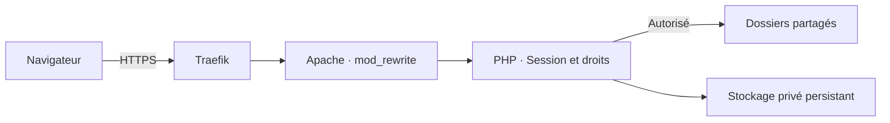

<div align="center">

# FileKeep for h5ai

**Un explorateur de fichiers en thème sombre, avec comptes utilisateurs, droits par dossier et journaux de sécurité.**


[Fonctionnalités](#fonctionnalités) · [Installation](#installation) · [Configuration](#configuration) · [Dépannage](#dépannage)

</div>

---

Cette version personnalisée de **h5ai 0.30.0** transforme un partage de fichiers
Apache en espace privé. Chaque utilisateur se connecte à son compte et consulte
uniquement les dossiers qui lui ont été attribués. Les administrateurs gèrent
les comptes et consultent l'historique depuis l'interface web.

Le déploiement présenté ici réutilise **un service PHP/Apache existant**, placé
derrière **Traefik**. Il ne nécessite ni base SQL, ni Composer, ni compilation du
frontend pour fonctionner.

> **À savoir avant l'installation**
>
> La protection des liens directs dépend du virtual host fourni. Installer
> uniquement les pages de connexion PHP ne protège pas les fichiers qu'Apache
> pourrait servir directement. La configuration fournie prend en charge tout
> `/var/www/html` et ignore les `.htaccess` des dossiers partagés.

## Fonctionnalités

| Fonction | Description |
| --- | --- |
| **Connexion privée** | Sessions PHP, déconnexion et option « Rester connecté » |
| **Administration** | Création de comptes, rôles, suppression et réinitialisation des mots de passe |
| **Première connexion** | Mot de passe temporaire généré, à remplacer avant tout accès aux fichiers |
| **Droits par dossier** | Autorisation d'un dossier entier ou de sous-dossiers précis |
| **Mon compte** | Modification de l'identifiant, du mot de passe et de la photo de profil |
| **Recadrage de photo** | Déplacement, zoom et aperçu rond ; export en 512 × 512 pixels |
| **Journaux** | Historique filtrable des connexions, changements et accès refusés |
| **Navigation** | Interface sombre, recherche configurable, aperçus et archives selon les options h5ai |
| **Médias** | Téléchargements et lecture partielle des fichiers avec prise en charge des requêtes HTTP Range |

### Les pages

| Adresse | Accès |
| --- | --- |
| `/` | Connexion, puis liste des fichiers autorisés |
| `/mon-compte` | Utilisateur connecté |
| `/administration` | Administrateur |
| `/journaux` | Administrateur |

Les anciennes adresses `/_h5ai/public/index.php`, avec ou sans paramètres,
et `/_h5ai/public/` répondent **404**, sans redirection. Les ressources CSS,
JavaScript et images restent chargées depuis leur emplacement interne.
Les routes applicatives sont réservées à la racine du partage.

## Fonctionnement



Apache réécrit les demandes de pages et de documents vers la passerelle PHP.
Celle-ci vérifie la connexion et les droits avant d'afficher un dossier ou de
transmettre un fichier. Les ressources visuelles de l'application sont publiques ;
les miniatures de documents restent protégées.

## Prérequis

- Un serveur Linux avec Docker et Docker Compose.
- Un service Apache compatible avec l'[image PHP officielle](https://github.com/docker-library/docs/blob/master/php/README.md) `php:…-apache`, disposant
  des commandes `a2enmod`, `apache2ctl` et `apache2-foreground`.
- Traefik déjà configuré pour votre domaine et HTTPS.
- Un réseau Docker partagé entre Traefik et Apache.
- Des dossiers persistants sur l'hôte pour les documents et les comptes.

Le code d'authentification impose PHP 7.3 minimum ; les vérifications locales ont
été exécutées sous **PHP 8.5**. L'exemple utilise `php:8.5-apache`. Vous pouvez
conserver votre image PHP/Apache existante si elle est compatible.

Ce guide configure Apache. Il ne fournit pas de configuration équivalente pour
Nginx ou Lighttpd.

## Installation

### 1. Installer les fichiers du projet

L'arborescence attendue dans le conteneur est :

```text
/var/www/html/
├── _h5ai/                  # Ce dépôt, avec ce nom de dossier
│   ├── deploy/
│   ├── private/
│   └── public/
├── Documents/              # Exemple de dossier partagé
└── Photos/                 # Autre partage éventuel
```

Pour une installation neuve :

```bash
sudo install -d /docker/apache2/website
sudo git clone https://github.com/KazuteruNishi/FileKeep-for-h5ai.git /docker/apache2/website/_h5ai
```

Si h5ai est déjà installé, sauvegardez sa configuration et transférez cette version
dans `/docker/apache2/website/_h5ai`.

Les chemins `/docker/apache2/...` présentés ci-dessous se trouvent **sur l'hôte
Docker**, et non dans le conteneur. Vous pouvez les adapter à votre installation.

### 2. Créer le compte administrateur initial

Préparez les dossiers sur l'hôte :

```bash
sudo install -d -m 750 /docker/apache2/auth
sudo install -d -o 33 -g 33 -m 700 /docker/apache2/auth/managed
```

Avec votre conteneur Apache **déjà démarré**, créez le fichier de comptes initial :

```bash
sudo docker exec -it apache htpasswd -cB -C 12 /tmp/h5ai-bootstrap.htpasswd admin

sudo docker exec apache cat /tmp/h5ai-bootstrap.htpasswd \
  | sudo tee /docker/apache2/auth/users.htpasswd > /dev/null

sudo chown root:33 /docker/apache2/auth/users.htpasswd
sudo chmod 640 /docker/apache2/auth/users.htpasswd
```

Le mot de passe est demandé deux fois, de manière interactive. La génération
se fait dans un fichier temporaire, puis seul son contenu est transféré : les
messages du terminal ne sont pas ajoutés au fichier de comptes.

> Ces commandes servent à l'initialisation et remplacent le fichier de comptes
> de destination. Si vous possédez déjà un `.htpasswd` bcrypt, réutilisez-le.
> Le nom `admin` doit correspondre exactement à `H5AI_ADMIN_USER` dans Compose.

<details>
<summary>Alternative : utiliser htpasswd directement sur l'hôte</summary>

Sur un hôte Debian/Ubuntu, l'utilitaire est fourni par `apache2-utils` :

```bash
sudo apt-get install apache2-utils
sudo htpasswd -cB -C 12 /docker/apache2/auth/users.htpasswd admin
sudo chown root:33 /docker/apache2/auth/users.htpasswd
sudo chmod 640 /docker/apache2/auth/users.htpasswd
```

L'option `-c` crée ou remplace le fichier. Pour ajouter un compte à un fichier
initial existant, utilisez `htpasswd -B -C 12` **sans `-c`**. Après l'import dans
l'application, les comptes se gèrent depuis l'administration web.
Les options sont détaillées dans la [documentation Apache de htpasswd](https://httpd.apache.org/docs/2.4/programs/htpasswd.html).

</details>

Seules les empreintes **bcrypt** (`$2y$`, `$2a$`, `$2b$`) sont importées. Les anciens
formats Apache `$apr1$` ou `{SHA}` doivent être remplacés.

### 3. Donner les droits d'écriture aux caches

L'image PHP/Apache officielle utilise `www-data`, UID/GID **33**. Si votre image
utilise un autre utilisateur, adaptez ces identifiants.

```bash
sudo chown -R 33:33 \
  /docker/apache2/website/_h5ai/private/cache \
  /docker/apache2/website/_h5ai/public/cache

sudo chmod -R u+rwX,go-rwx \
  /docker/apache2/website/_h5ai/private/cache \
  /docker/apache2/website/_h5ai/public/cache
```

Les comptes, les photos, les journaux et les jetons seront stockés séparément
dans `/docker/apache2/auth/managed`. Ce dossier reste hors du répertoire web.

### 4. Adapter le service Apache existant

Voici un **bloc à intégrer à votre Compose existant**, en conservant le service
Traefik et la définition de votre réseau `frontend`.

Remplacez :

- `fichiers.example.com` par votre domaine ;
- `letsencrypt` par le nom de votre résolveur de certificats Traefik ;
- `/srv/partage/Documents` par un dossier de documents existant ;
- l'image PHP si vous conservez une autre version compatible.

```yaml
services:
  apache:
    container_name: apache
    image: php:8.5.12-apache
    restart: unless-stopped

    command:
      - /bin/sh
      - -ec
      - |
        a2enmod rewrite
        apache2ctl -t
        exec apache2-foreground

    environment:
      H5AI_AUTH_FILE: /run/secrets/h5ai.htpasswd
      H5AI_ADMIN_USER: admin
      H5AI_USERS_DIR: /var/lib/h5ai/users
      H5AI_AUTH_STATE: /var/lib/h5ai/users/login-attempts
      H5AI_HTTPS: "1"
      H5AI_STORYBOARD_WORKER: external

    volumes:
      - /docker/apache2/website:/var/www/html
      - /srv/partage/Documents:/var/www/html/Documents:ro
      - /docker/apache2/auth/users.htpasswd:/run/secrets/h5ai.htpasswd:ro
      - /docker/apache2/auth/managed:/var/lib/h5ai/users:rw
      - /docker/apache2/website/_h5ai/deploy/apache-h5ai.conf:/etc/apache2/sites-available/000-default.conf:ro
      - /docker/apache2/website/_h5ai/deploy/auth.ini:/usr/local/etc/php/conf.d/h5ai-auth.ini:ro

    labels:
      - traefik.enable=true
      - 'traefik.http.routers.files-http.rule=Host(`fichiers.example.com`)'
      - traefik.http.routers.files-http.entrypoints=web
      - traefik.http.routers.files-http.middlewares=files-force-https
      - traefik.http.routers.files-http.service=files
      - traefik.http.middlewares.files-force-https.redirectscheme.scheme=https
      - traefik.http.middlewares.files-force-https.redirectscheme.permanent=true
      - 'traefik.http.routers.files-https.rule=Host(`fichiers.example.com`)'
      - traefik.http.routers.files-https.entrypoints=websecure
      - traefik.http.routers.files-https.tls=true
      - traefik.http.routers.files-https.tls.certresolver=letsencrypt
      - traefik.http.routers.files-https.service=files
      - traefik.http.services.files.loadbalancer.server.port=80

    networks:
      - frontend
```

Cet extrait n'installe pas Traefik et ne déclare pas le réseau : ils doivent déjà
exister dans votre configuration. Pour ajouter un autre partage, ajoutez un
montage de volume sous `/var/www/html/NomDuDossier`.

La configuration Apache fournie remplace le virtual host par défaut et réserve
ce site à h5ai. Les autres applications PHP placées dans ce même répertoire ne
seront pas exécutées. Aucun port Apache n'a besoin d'être publié sur l'hôte
lorsque Traefik assure l'accès au site.

> Les fichiers `deploy/apache-h5ai.conf` et `deploy/auth.ini` doivent exister
> **avant** la création du conteneur. Une source absente dans un montage Docker
> peut devenir un dossier et provoquer l'erreur « not a directory ».

L'extrait minimal [deploy/compose.apache.yml](deploy/compose.apache.yml) sert
aussi de référence pour une installation existante. Aucune nouvelle image
n'est imposée en production.

### 5. Démarrer et vérifier

Depuis le dossier du **Compose qui gère déjà votre service Apache** :

```bash
sudo docker-compose config --quiet
sudo docker-compose up -d --no-deps --no-build apache
sudo docker exec apache apache2ctl -t
```

Le résultat attendu est `Syntax OK`.

Les commandes utilisent `docker-compose`. Si votre projet a été créé avec un nom explicite,
conservez-le avec `-p NOM_DU_PROJET`.

Ouvrez ensuite :

```text
https://fichiers.example.com/
```

Connectez-vous avec le compte initial et ouvrez **Administration** depuis le menu
du compte, en haut à droite.

## Configuration

| Variable | Utilité | Valeur de l'exemple |
| --- | --- | --- |
| `H5AI_AUTH_FILE` | Fichier bcrypt importé à l'initialisation | `/run/secrets/h5ai.htpasswd` |
| `H5AI_ADMIN_USER` | Compte promu administrateur lors du premier import | `admin` |
| `H5AI_USERS_DIR` | Stockage privé persistant et accessible en écriture | `/var/lib/h5ai/users` |
| `H5AI_AUTH_STATE` | Dossier des compteurs de tentatives, séparés par compte | `/var/lib/h5ai/users/login-attempts` |
| `H5AI_HTTPS` | `1` pour les cookies Secure derrière le proxy HTTPS | `1` |
| `H5AI_TRUSTED_PROXIES` | Adresses ou CIDR des proxys de confiance pour les journaux | Vide par défaut |

Le `.htpasswd` est importé **une seule fois**. Après création de `users.json`,
modifier ce fichier initial ou `H5AI_ADMIN_USER` ne modifie pas les comptes existants.
Si plusieurs comptes sont importés, seul le compte désigné devient administrateur ;
les autres commencent sans dossier autorisé.

Les options générales de h5ai restent dans [private/conf/options.json](private/conf/options.json).
Certaines fonctions, comme la recherche, sont désactivées par défaut. Les aperçus
et archives dépendent également des extensions PHP et outils disponibles dans
votre image ; l'application n'installe pas GD, FFmpeg ou ImageMagick automatiquement.

### IP réelle derrière Traefik

Par défaut, les journaux utilisent l'adresse réseau directe, qui peut être celle
de Traefik. Pour trouver son adresse sur le réseau partagé avec Apache :

```bash
sudo docker inspect traefik --format '{{range $nom, $reseau := .NetworkSettings.Networks}}{{$nom}} : {{$reseau.IPAddress}}{{println}}{{end}}'
```

Ajoutez **l'adresse réellement obtenue** à l'environnement Apache. Exemple :

```yaml
H5AI_TRUSTED_PROXIES: "172.21.0.2"
```

Puis réappliquez le service avec `docker-compose up -d --no-deps --no-build apache`.
Une liste séparée par des virgules et les CIDR IPv4/IPv6 sont acceptés. Déclarez
uniquement les proxys approuvés ; mettez à jour la valeur si Traefik change d'IP.
Les en-têtes `X-Forwarded-For` des autres sources sont ignorés.

## Utilisation

### Créer et gérer un utilisateur

1. Ouvrez `/administration` et choisissez un identifiant et un rôle.
2. Pour un utilisateur, sélectionnez les dossiers autorisés.
3. Créez le compte : un **mot de passe temporaire de 20 caractères** s'affiche une fois.
4. Transmettez ces identifiants à l'utilisateur.
5. À sa première connexion, il doit choisir son propre mot de passe avant d'accéder aux fichiers.

Un nouveau mot de passe doit contenir **12 caractères minimum**, une majuscule,
une minuscule et un caractère spécial, avec un maximum de **72 octets** pour bcrypt.

Le bouton **Générer un nouveau mot de passe temporaire** réinitialise un compte
existant, invalide ses connexions et impose un nouveau changement à la connexion
suivante. Le rôle, les dossiers autorisés et la photo sont conservés.

### Attribuer les dossiers

| Choix | Résultat |
| --- | --- |
| `/Documents` | Accès à Documents et à tous ses sous-dossiers |
| `/Documents/Factures` uniquement | Accès limité à Factures ; Documents sert seulement à naviguer |
| Aucun dossier | Aucun accès aux fichiers |
| Tous les dossiers | Accès au partage complet, y compris les fichiers à la racine |
| Administrateur | Accès complet et gestion des comptes ; choix des dossiers masqué |

Les droits sont contrôlés sur les liens directs, les listes, les recherches,
les miniatures et les archives. Modifier un compte déconnecte **uniquement les
sessions de ce compte**, sans déconnecter les autres utilisateurs.

### Personnaliser son compte

Depuis `/mon-compte`, chaque utilisateur peut modifier son identifiant, son mot
de passe et sa photo. Le mot de passe actuel est demandé pour enregistrer les changements.

Le recadrage accepte des sources JPEG, PNG ou WebP jusqu'à 10 Mo, avec un maximum
de 24 mégapixels et de 8192 pixels par côté. Après déplacement et zoom, cliquez
sur **Utiliser ce cadrage**, puis enregistrez : seul le JPEG carré de **512 × 512**
est envoyé. Les photos sont privées et visibles uniquement par leur propriétaire.

### Consulter les journaux

La page `/journaux` est réservée aux administrateurs. Elle propose des filtres
par dates, utilisateur, événement et résultat, avec 50 événements par page.

Les événements couvrent notamment les connexions et échecs, déconnexions,
réinitialisations et changements de mots de passe, modifications de comptes et
de droits, refus d'accès et consultations des journaux eux-mêmes.

- Conservation de **60 jours**, heures affichées en Europe/Paris.
- Rotation en deux segments maximum de 5 Mio par jour, soit **10 Mio/jour**.
- Alerte visible si le plafond est atteint ou si l'écriture est indisponible.
- Aucun mot de passe, empreinte bcrypt, cookie ou jeton n'est enregistré.
- Aucun import automatique des anciens journaux Apache.

### Lire des vidéos et leurs sous-titres ASS

Le lecteur utilise **Shaka Player 5.3.3**, avec son interface et ses styles
officiels hébergés localement. Il propose le volume, la progression, la vitesse
et le plein écran. Sur un MKV, les pistes ASS sont recherchées automatiquement
après le chargement de la vidéo. Choisissez la piste dans le menu natif
**Sous-titres** de Shaka, accessible par son icône dans la barre du lecteur ou
par les paramètres. L'option **Désactivés** utilise également ce menu natif.
Les sous-titres restent désactivés tant qu'aucune piste n'a été sélectionnée.
Le **Décalage des sous-titres** et la vitesse se règlent dans les paramètres
de Shaka, avec ses sous-menus. Aucun panneau ASS séparé n'est ajouté.
Le lecteur reçoit ses propres événements de souris et de clavier :
l'aperçu h5ai ne doit pas annuler les actions sur ses commandes.

Les chapitres simples intégrés aux MKV sont lus dans l'édition par défaut.
La barre est alors découpée en segments : le chapitre survolé s'agrandit,
son nom accompagne l'aperçu et le chapitre courant apparaît à côté du temps,
sans action au clic. Sans chapitres, l'affichage habituel est conservé.
Le volume et l'état muet choisis sont conservés lors du passage à une autre
vidéo, y compris avec le décodage audio logiciel. Cette préférence est enregistrée
localement dans le navigateur et restaurée après rechargement ou réouverture du
site. Si le stockage du navigateur est indisponible, elle reste conservée dans
l'onglet pendant la navigation entre vidéos.
Les éditions ordonnées, qui peuvent définir un montage différent ou relier
plusieurs fichiers, ne sont pas présentées comme des repères de la vidéo native.

L'extraction des pistes ASS/SSA des fichiers MKV est réalisée en PHP ; leur
affichage utilise JASSUB/libass dans le navigateur, avec les styles et les polices
jointes lorsqu'elles sont disponibles. Les sous-titres n'exigent aucun décodeur
sur le serveur. Les planches d'aperçus utilisent FFmpeg et FFprobe, installés par
`deploy/Dockerfile` dans le conteneur séparé `storyboards`. Les fichiers JavaScript, WebAssembly
et la police de remplacement sont livrés dans `public/js/jassub`. Shaka est livré
dans `public/js/shaka` et `public/css/shaka`. Aucune police Google ni autre
ressource distante n'est nécessaire à l'interface.

- La première analyse parcourt les éléments MKV en sautant les données vidéo et
  audio. Elle est limitée à 25 secondes de traitement et peut échouer sur des
  fichiers particulièrement volumineux ou atypiques.
- Les résultats sont conservés dans `H5AI_USERS_DIR/media`, avec contrôle des
  droits à chaque accès, invalidation quand le fichier change et nettoyage des
  caches de plus de 7 jours lors d'une nouvelle extraction.
- Limites : 16 Mio de sous-titres, 32 polices, 4 Mio par police et 16 Mio de polices
  au total. Le cache est plafonné à environ 512 Mio. Les nouvelles extractions
  sont limitées à 10 par compte sur une période de 15 minutes.
- Les pistes compressées, les sous-titres images PGS/VobSub et les fichiers
  contenant des sous-titres sans durée explicite ne sont pas pris en charge.
- Le navigateur doit toujours savoir décoder la vidéo : aucun transcodage vidéo
  n'est effectué. L'audio AAC conserve sa lecture native. Pour la piste audio
  principale en FLAC, AC3, E-AC3 ou DTS, un moteur logiciel utilise Mediabunny
  pour lire le MKV par requêtes Range. Le FLAC utilise libFLAC WebAssembly ;
  AC3/E-AC3 et DTS utilisent les extensions Mediabunny basées sur libavcodec
  (FFmpeg), exécutées en WebAssembly dans le navigateur.
  Les fichiers sont fournis dans `public/js/audio` et `public/js/flac-audio.js` :
  Ce décodage audio reste dans le navigateur ; FFmpeg dans `storyboards` sert aux planches.
- Pour ces formats, le menu Shaka **Paramètres → Piste audio** permet de choisir
  entre les pistes FLAC, AC3, E-AC3 et DTS quand plusieurs sont présentes. Les
  décodeurs nécessaires sont chargés uniquement à la demande.
- Le son décodé suit le volume, le bouton muet, la pause, les déplacements et la
  vitesse du lecteur. Le navigateur peut demander un clic pour activer le son.
  Seules quelques secondes de son sont préparées à l'avance ; la vidéo complète
  n'est pas téléchargée en mémoire. La vitesse logicielle peut modifier la
  hauteur du son, contrairement à la correction de hauteur de certains lecteurs
  natifs. Les pistes multicanales sont adaptées à la sortie stéréo, y compris
  les canaux centraux pour conserver les dialogues. Le moteur est libéré à la
  fermeture de l'aperçu. Les variantes DTS-HD/immersives ne sont pas garanties
  au-delà des capacités du décodeur fourni.
- Pour les fichiers dont la piste principale est lue nativement, le choix des
  pistes audio dépend toujours des possibilités du navigateur.

**Mise à jour d'une installation existante :** transférer aussi
`deploy/apache-h5ai.conf`, qui autorise les fichiers `.wasm` du moteur de
sous-titres et leur associe le bon type MIME, puis redémarrer Apache.
Le plein écran du lecteur inclut les sous-titres.

### Planches permanentes des aperçus

Le panneau d'informations affiche les images en conservant leurs proportions.
Pour une vidéo, il utilise une miniature des planches déjà disponibles ; à défaut,
l'icône Play reste visible. La liste des fichiers utilise également ces miniatures,
avec un symbole Play superposé pour les vidéos. Les dimensions des emplacements
restent inchangées. Les miniatures de la liste sont chargées à l'approche de la
zone visible ; leur consultation ne met pas de nouvelles vidéos en génération.

La première ouverture d'une vidéo met sa génération en file d'attente. Le worker
PHP lance FFmpeg dans un conteneur séparé, sans dépendre de la durée
de lecture ni de l'onglet. Jusqu'à dix vidéos sont traitées en parallèle, avec un thread
de décodage. Les planches achevées sont utilisables pendant la génération des suivantes.

- Stockage : `H5AI_USERS_DIR/storyboards`, soit `/docker/apache2/auth/managed/storyboards`
  sur l'hôte avec la configuration fournie. Il n'apparaît pas dans l'interface,
  même pour l'admin, et reste accessible directement sur la machine.
- Une planche regroupe 25 miniatures de **192 × 108 pixels**, sans version plus grande.
  Le pas commence à deux secondes et augmente sur les vidéos longues pour limiter
  la collection à environ 1 800 miniatures par vidéo.
- L'identité des planches est le SHA-256 complet du contenu. Le calcul est réalisé
  en arrière-plan. Après déplacement, renommage ou copie, le contenu est identifié
  à nouveau puis les planches existantes sont réutilisées, sans nouvelle génération.
- Les planches et leurs index sont conservés **sans expiration** et ne participent
  pas au nettoyage du cache des sous-titres. Prévoir l'espace disque correspondant.
- Chaque accès à une planche vérifie les droits sur la vidéo actuelle. Le lecteur
  précharge la planche courante et ses voisines, avec au plus six planches décodées
  en mémoire. Les anciennes captures à la demande servent de repli pendant la préparation.
- Si le générateur est arrêté, les planches terminées restent présentes. Le worker relancé
  au démarrage reprend la file et les planches manquantes. Les erreurs sont écrites
  dans `H5AI_USERS_DIR/storyboards/worker.log`.

Pour activer cette fonction sur une installation existante, transférer les nouveaux
fichiers PHP/JavaScript et `deploy/Dockerfile`. Garder l’image Apache actuelle et
ajouter `H5AI_STORYBOARD_WORKER: external` à son environnement. Ajouter le service
`storyboards` de `deploy/compose.apache.yml` au même Compose. Le Dockerfile construit
uniquement le générateur PHP CLI + FFmpeg.
La version PHP se définit uniquement dans `storyboards.build.args.PHP_IMAGE` du
Compose ; le Dockerfile reçoit cette valeur avec `ARG PHP_IMAGE`, sans défaut.

```yaml
services:
  storyboards:
    build:
      context: /docker/apache2/website/_h5ai/deploy
      dockerfile: Dockerfile
      args:
        PHP_IMAGE: php:8.5.12-cli
```

Cet extrait complète le service entier fourni dans `deploy/compose.apache.yml`.
Le Dockerfile commence par `ARG PHP_IMAGE` puis `FROM ${PHP_IMAGE}` : aucun fichier
`.env` n'est nécessaire pour cette version. Choisir une image officielle PHP CLI
compatible avec `apt-get`, sans suffixe `alpine`. La version de FFmpeg provient
des dépôts de cette image et est installée lors de la construction.

Reproduire tous les montages de vidéos d’Apache aux mêmes chemins internes dans
le générateur, en lecture seule.
Seul le dossier des planches est partagé en écriture, pas les comptes ni les mots
de passe. Le générateur tourne avec UID/GID 33, sans réseau ni port exposé.

```sh
sudo mkdir -p /docker/apache2/auth/managed/storyboards
sudo chown 33:33 /docker/apache2/auth/managed/storyboards
sudo chmod 700 /docker/apache2/auth/managed/storyboards
cd /docker/docker-build
sudo docker-compose config --quiet
sudo docker-compose build --pull --no-cache storyboards
sudo docker-compose up -d --no-deps storyboards
sudo docker-compose up -d --no-deps --no-build apache
```

Apache est recréé pour charger la variable avec son image actuelle. Le générateur
surveille la file toutes les secondes et reprend les travaux après redémarrage.
Apache ne dépend pas du générateur : son arrêt ou son redémarrage ne bloque ni
le site ni la lecture. Les nouvelles planches attendent son retour ; celles déjà
créées restent accessibles. Le lecteur conserve les captures à la demande en repli.
Le service fourni limite l'ensemble du générateur à un CPU, 2 Gio sans swap et 256 processus,
avec redémarrage automatique après un plantage. Ces limites concernent uniquement
le générateur et peuvent être ajustées à la machine.
Faire Ctrl+F5 après le transfert des fichiers du lecteur.
Sans `H5AI_STORYBOARD_WORKER=external`, le mode intégré reste disponible et exige
FFmpeg dans Apache.
Le volume privé existant doit rester monté en écriture et appartenir à UID 33.
`H5AI_FFMPEG` et `H5AI_FFPROBE` peuvent définir les chemins des exécutables ; sinon
les commandes `ffmpeg` et `ffprobe` du conteneur sont utilisées.
`H5AI_PHP_CLI` permet de préciser le PHP CLI si son chemin diffère de celui
fourni par l'image officielle.

### Commandes utiles pour les planches

Le service `storyboards` lance jusqu'à **10 travaux en parallèle** par défaut.
Le réglage se fait uniquement dans son environnement Compose :

```yaml
environment:
  H5AI_USERS_DIR: /var/lib/h5ai/users
  H5AI_STORYBOARD_WORKER: external
  H5AI_STORYBOARD_CONCURRENCY: "10"
```

La valeur est comprise entre 1 et 32. Chaque place prend la prochaine vidéo de
la file, selon l'ordre manuel ou les priorités et le tri alphabétique. Une vidéo
terminée libère immédiatement une place ; il ne s'agit pas de lots bloquants.
L'ordre est celui des démarrages : des vidéos lancées ensemble peuvent terminer
dans un ordre différent selon leur durée et leur complexité.
La pause et l'arrêt concernent tous les travaux actifs. Les vidéos identiques
partagent un verrou pour empêcher deux écritures simultanées sur les mêmes planches.
Le mode intégré sans `--watch` reste séquentiel.

Les limites Compose sont partagées par tous les travaux, pas par vidéo. Avec
dix décodeurs, l'exemple utilise `mem_limit: 2g`, `memswap_limit: 2g` et
`pids_limit: 256`. Le CPU reste limité à `cpus: 1.0` pour protéger les autres
services : dix travaux ne signifient donc pas une vitesse dix fois supérieure.
Adapter la limite CPU aux ressources disponibles si nécessaire. Les vidéos
haute résolution peuvent demander davantage de mémoire ; une erreur de travail
est affichée dans la page sans bloquer les autres vidéos ni Apache.

Après transfert des fichiers PHP, appliquer le réglage sans reconstruire l'image :

```bash
cd /docker/docker-build
sudo docker-compose up -d --no-deps --no-build --force-recreate storyboards
```

Les administrateurs disposent aussi de la page **Aperçus vidéo**, accessible dans
le menu du compte à `/administration/apercus`. Elle présente les vidéos connues
terminées, en génération, en attente et en erreur, avec actualisation toutes les
trois secondes.
Chaque catégorie dispose d'un tableau avec les colonnes fichier/dossier, état,
priorité et progression. Chaque tableau possède une recherche indépendante sur
les noms et chemins, insensible à la casse et aux accents, et une pagination de
dix vidéos avec compteur de résultats et boutons précédent/suivant. La recherche
et la page choisie sont conservées pendant les actualisations ; la recherche
revient à la première page quand son texte change. La page est ajustée si le
nombre de résultats diminue. Les tableaux défilent horizontalement sur petit écran.
La file conserve ses positions réelles même pendant une recherche ; les flèches
déplacent chaque vidéo par rapport à ses voisines dans la file complète.
Uniquement dans **En attente**, la colonne **Priorité** est modifiable directement
avec une liste déroulante Basse/Normale/Haute/Urgente. Le changement est enregistré
immédiatement et rétablit le tri automatique par priorité puis nom, même si un
ordre manuel était actif. Les travaux déjà démarrés ne sont pas interrompus.
Ce menu utilise la palette sombre du site, une coche sur le choix actif et aucun
champ de recherche. Il accepte les flèches du clavier, Entrée et Échap, et reste
visible au-dessus du tableau sans être découpé par son défilement.
Après un changement de priorité ou d'ordre, le tableau conserve la page courante
et la recherche. Une vidéo déplacée vers une autre page n'est pas suivie automatiquement.
La confirmation précise le nom et la priorité enregistrée ; la vidéo est brièvement
mise en évidence si elle reste sur la page affichée. La page n'est ajustée que si
elle n'existe plus après une diminution du nombre de résultats.
Les autres catégories gardent un badge en lecture seule. Le serveur refuse la
modification directe si la vidéo a quitté la file entre l'affichage et la validation.
Dans **En cours**, un bouton devant chaque vidéo permet de mettre uniquement
son traitement en pause puis de le reprendre. La vidéo reste dans ce tableau
avec l'état **En pause** et sa progression conservée. Sa place reste réservée :
elle n'est pas remplacée par la prochaine vidéo de la file. Les autres places
continuent de fonctionner. Play reprend cette même vidéo en priorité sur sa
place réservée, avec un état transitoire **Reprise…**, sans la renvoyer dans
**En attente**. La reprise repart des planches complètes déjà produites. Une pause pendant le calcul
de l'empreinte impose de recommencer ce calcul. Les pauses individuelles sont
persistantes et ne sont pas levées par le bouton global **Reprendre** ; utiliser
le bouton Play de la vidéo. **Arrêter et vider la file** annule aussi ces travaux.
Le titre distingue les traitements actifs des vidéos en pause. La colonne Action
garde une largeur fixe et les noms utilisent l'espace restant. Les fichiers CSS
et JavaScript de cette page portent une empreinte de leur contenu dans leur URL
pour renouveler le cache à chaque mise à jour.

Après un arrêt brutal du conteneur, le générateur réconcilie automatiquement les
index et la file avant de lancer des travaux. Un traitement resté en calcul ou
en génération sans processus actif passe en **Reprise…**, même si son fichier
de file avait disparu. Les planches complètes sont conservées et les travaux
interrompus reprennent avant les nouvelles vidéos. Une génération déjà achevée
est reconnue sans la refaire. Les pauses individuelles et globales ainsi que les
annulations restent respectées ; un verrou encore détenu n'est pas supprimé.
L'empreinte connue est réutilisée si la signature de la vidéo n'a pas changé.
Une source absente ou modifiée passe en erreur au lieu de rester faussement active.

Si un sous-processus disparaît pendant que le superviseur fonctionne, il est
relancé automatiquement, avec un maximum de trois tentatives avant passage en
erreur. Les erreurs normales de décodage restent dans la catégorie En erreur.
Pour charger cette récupération sur une installation existante, transférer
`private/php/core/class-storyboards.php`, puis exécuter
`sudo docker-compose restart storyboards`. Les anciens traitements bloqués sont
récupérés au démarrage ; aucune suppression manuelle de verrou n'est nécessaire.
La catégorie **Annulées** regroupe les traitements arrêtés. Son bouton **Vider
l'historique** retire toutes les annulations affichées, même lorsqu'une recherche
est active. Les vidéos, les planches et leurs index sont conservés ; les autres
catégories restent inchangées. Une vidéo relancée puis annulée de nouveau réapparaît
dans l'historique. Cette action est réservée aux administrateurs et protégée par CSRF.
Une corbeille rouge en fin de ligne permet aussi d'agir individuellement : dans
**En attente**, elle annule uniquement ce traitement et le déplace vers **Annulées** ;
dans **Annulées**, elle retire uniquement cette entrée de l'historique. Les vidéos,
les planches et leurs index sont conservés. Une vidéo déjà démarrée ne peut pas
être annulée depuis le tableau d'attente ; actualiser puis utiliser ses commandes.
Les tableaux **Terminés**, **Annulées** et **En erreur** affichent les événements
du plus récent au plus ancien. La date de fin, d'annulation ou d'échec est
enregistrée pour les nouveaux événements ; les anciennes entrées utilisent la
date de modification de leur index. La file d'attente conserve son ordre de traitement.
Chaque historique affiche une colonne **Date et heure**, au format français
avec les secondes et le fuseau **Europe/Paris** (heure d'été/hiver automatique).
Les catégories **Terminés** et **En erreur** disposent également d'un bouton
**Vider l'historique** et d'une corbeille par ligne. Chaque action est limitée à
sa catégorie ; les traitements actifs et la file d'attente restent inchangés.
La suppression de l'historique conserve les index et les planches : les aperçus
terminés restent utilisables et ne sont pas régénérés au prochain préchargement.
Cliquer sur un nom de vidéo ouvre son dossier dans un nouvel onglet et lance
automatiquement le lecteur habituel sur cette vidéo, avec ses sous-titres et
la navigation précédente/suivante du dossier. Le lien conserve les contrôles
d'accès du site et la page de suivi reste ouverte.
La page affiche aussi la taille totale des fichiers du dossier privé des aperçus,
en incluant les planches, index et fichiers de fonctionnement
du générateur. Le pourcentage de génération est estimé à partir des miniatures
produites ; le calcul de l'empreinte est affiché sans pourcentage. Les anciens
chemins de fichiers déplacés ou remplacés sont exclus de la liste.

Le bouton **Précharger toutes les vidéos** demande au conteneur `storyboards`
d'exécuter la même recherche que `--enqueue-all`. La recherche est prise en charge
par le superviseur, même si des vidéos sont déjà en cours, et ne dépend pas de la page
ouverte. Si le générateur est arrêté, la demande reste en attente de son retour.
La page, ses données et l'action de préchargement sont réservées aux
administrateurs ; l'action est protégée par le jeton CSRF.

La page permet de **mettre en pause**, **reprendre** ou **arrêter et vider la
file**. La pause interrompt le calcul en cours tout en conservant la file. La
reprise conserve les planches complètes ; la planche interrompue est recréée.
Le calcul d'empreinte interrompu doit recommencer. L'arrêt annule les vidéos
en cours et en attente sans supprimer les planches produites. Pour relancer des
vidéos arrêtées, les sélectionner à nouveau, valider leur préchargement puis
cliquer sur **Reprendre**. Le site et la lecture restent indépendants de ces actions.

Le menu de sélection s'ouvre comme une liste déroulante avec recherche, groupes
par dossier et cases à cocher. Il permet de naviguer dans les dossiers et de
chercher dans leurs sous-dossiers ; les sélections restent cochées pendant la
navigation. Cocher un dossier inclut récursivement ses vidéos. Cocher un fichier
ou sous-dossier désélectionne ses parents sélectionnés ; cocher un parent retire
les sélections de ses descendants. Les dossiers voisins restent sélectionnés.
Jusqu'à 200 fichiers
ou dossiers peuvent être sélectionnés ; une recherche affiche au plus 300 résultats.
Les choix ne sont appliqués qu'après validation dans le menu.
Les fichiers dont les aperçus sont terminés sont grisés et non sélectionnables.
Un dossier est désactivé seulement si toutes ses vidéos, sous-dossiers compris,
sont terminées ; un dossier partiellement traité reste sélectionnable. Le bouton
**Ouvrir** reste disponible pour consulter le contenu d'un dossier terminé. Ces
états s'actualisent pendant que le menu est ouvert, sans réinitialiser la recherche
ni déplacer le défilement. Les sélections devenues complètes sont retirées.

Choisir une priorité **Basse**, **Normale**, **Haute** ou **Urgente**, puis utiliser
**Précharger la sélection** pour mettre les vidéos en file, ou **Appliquer la
priorité seulement** pour réordonner les vidéos déjà connues. Une priorité définie
sur un fichier prend le pas sur celle de son dossier ; le dossier parent le plus
proche s'applique sinon. Les priorités sont persistantes et relues avant chaque
vidéo. Elles ne coupent pas celle en cours. À priorité égale, les travaux suivent
l'ordre alphabétique naturel de leur chemin (dossiers puis fichiers, sans tenir
compte de la casse ; épisode 2 avant épisode 10). Ce tri s'applique au préchargement
global, aux sélections et à la commande CLI. La section **En attente** affiche les
positions calculées par le serveur avec le même tri que le générateur, priorités
comprises. Une sélection validée pendant une pause attend la
reprise. Les nouvelles demandes ne remplacent pas celles déjà en attente.

Dans **En attente**, la poignée à six points permet de glisser une vidéo avant
ou après une autre. Les flèches permettent de la monter ou descendre d'une place,
y compris au clavier ou sur mobile. Chaque déplacement est enregistré sur le
serveur et passe la file en **ordre manuel**, qui prend le pas sur les priorités.
Les vidéos déjà en cours ne sont pas interrompues. Les nouvelles vidéos sont ajoutées
après la file manuelle existante, puis triées selon leurs priorités et leurs noms.
Les actualisations ne remplacent pas les lignes pendant un glisser-déposer.

**Rétablir le tri automatique** supprime l'ordre manuel et réapplique les priorités
puis l'ordre alphabétique naturel. Appliquer une priorité depuis le menu de sélection
rétablit également ce tri automatique. L'ordre manuel est conservé après redémarrage
du générateur ; arrêter et vider la file le supprime. Les commandes de déplacement
sont réservées aux administrateurs et protégées par le jeton CSRF.

Un générateur déjà démarré conserve le code PHP chargé en mémoire : transférer
les fichiers ne suffit donc pas à mettre à jour son algorithme de file. Après
installation de cette version, exécuter `sudo docker-compose restart storyboards`
une première fois. La page signale ensuite les différences de version entre le
générateur et le site. Le générateur surveille ses fichiers PHP entre les vidéos
et pendant l'attente ; une modification le fait quitter avec le code 75. La
politique `restart: unless-stopped` du Compose le relance avec le nouveau code.
Une génération déjà démarrée termine avant ce rechargement automatique.
L'état pause/arrêt est lui aussi persistant : redémarrer le conteneur ne réactive
pas le traitement. Utiliser **Reprendre** depuis la page pour le réactiver.

Après transfert des fichiers PHP, JavaScript et CSS de cette page, redémarrer le
générateur pour charger sa nouvelle boucle de surveillance :

```bash
cd /docker/docker-build
sudo docker-compose restart storyboards
```

Exécuter les commandes Compose depuis `/docker/docker-build`, dans le même projet
que le service Apache. Elles ne nécessitent pas de démarrer le lecteur.

**Générer les aperçus de toutes les vidéos.** Cette commande parcourt les dossiers
montés sous `/var/www/html` dans le générateur et met les vidéos en file sans les
ouvrir dans le lecteur. Les dossiers cachés, liens symboliques et sources de
l'application sont exclus. Les vidéos déjà connues ne sont pas ajoutées à nouveau ;
les erreurs de plus de 60 secondes peuvent être retentées. Les formats pris en
charge sont MP4, M4V, MKV, WebM et MOV.

```bash
cd /docker/docker-build
sudo docker-compose exec -T storyboards php /var/www/html/_h5ai/private/php/storyboard-worker.php --enqueue-all
```

Le générateur doit être démarré. La commande termine après la mise en file ; le
service traite ensuite jusqu'à dix vidéos simultanément, même sans lecteur ouvert. Il ne
recalcule pas les planches terminées. Les vidéos ajoutées ultérieurement peuvent
être prises en compte en relançant la commande. Transférer les versions à jour de
`private/php/storyboard-worker.php` et `private/php/core/class-storyboards.php`
avant la première utilisation ; ces fichiers sont montés dans le conteneur et
ne nécessitent pas une reconstruction de l'image.

**Démarrer tous les services du Compose.** Après la préparation initiale des
dossiers et le transfert des fichiers, cette commande construit le générateur
si nécessaire et démarre Traefik, Apache et le générateur en arrière-plan. Elle
applique aussi les modifications de configuration aux conteneurs concernés.
Elle ne déclenche pas la génération des planches de toutes les vidéos : chaque
vidéo entre en file à sa première ouverture.

```bash
cd /docker/docker-build
sudo docker-compose up -d --build
```

**Mettre à jour le générateur.** Après modification de `build.args.PHP_IMAGE`,
reconstruire l'image puis recréer uniquement ce conteneur. Un simple redémarrage
ne charge pas une nouvelle image de base ; les planches stockées restent présentes.

```bash
cd /docker/docker-build
sudo docker-compose config --quiet
sudo docker-compose build --pull --no-cache storyboards
sudo docker-compose up -d --no-deps storyboards
```

**Appliquer la configuration Apache.** Cette commande recrée Apache avec son image
locale pour charger les nouvelles variables ou les nouveaux montages ; elle
n'installe pas FFmpeg dans Apache.

```bash
sudo docker-compose up -d --no-deps --no-build apache
```

**Vérifier le générateur et ses erreurs.** Le service doit être `Up`. Les erreurs
de traitement sont aussi enregistrées dans le dossier privé. `worker.log` peut
ne pas exister tant qu'aucune erreur n'a été enregistrée.

```bash
sudo docker-compose ps storyboards
sudo docker-compose logs --tail=100 storyboards
sudo tail -n 50 /docker/apache2/auth/managed/storyboards/worker.log
```

**Voir l'état de chaque vidéo.** Le générateur traite les vidéos en parallèle,
indépendamment de la position de lecture. Les vidéos au-delà de la limite
attendent une place libre.

```bash
sudo docker-compose exec -T storyboards php -r '
foreach (glob("/var/lib/h5ai/users/storyboards/index/*.json") as $file) {
    $job = json_decode(file_get_contents($file), true);
    echo ($job["status"] ?? "?"), " | ", ($job["source"] ?? "?"), PHP_EOL;
}'
```

| État | Signification |
| --- | --- |
| `queued` | Vidéo en attente |
| `hashing` | Calcul du SHA-256 complet, avant les premières planches |
| `generating` | Création des planches |
| `ready` | Traitement terminé |
| `error` | Échec : consulter les journaux |

**Surveiller la création après fermeture du lecteur.** Le compteur porte sur
toutes les vidéos. Il augmente à chaque nouvelle planche, pas pendant le calcul
initial de l'empreinte. Une planche contient 25 miniatures ; une vidéo génère
plusieurs planches. Quitter avec Ctrl+C.

```bash
sudo watch -n 5 'find /docker/apache2/auth/managed/storyboards/assets -type f -name "sheet-*.jpg" | wc -l'
```

**Mesurer le stockage permanent.** Les planches n'expirent pas : cette commande
permet de suivre l'espace disque occupé.

```bash
sudo du -sh /docker/apache2/auth/managed/storyboards
```

**Arrêter ou relancer uniquement le générateur.** Apache et la lecture restent
indépendants. Après relance, les travaux en file reprennent sans supprimer les
planches achevées.

```bash
sudo docker-compose stop storyboards
sudo docker-compose start storyboards
```

**Confirmer l'utilisation des planches dans le navigateur.** Dans F12 → Réseau,
filtrer sur `lecture/planches`, puis ouvrir la vidéo et survoler la barre. Une
réponse JSON `status: ready` indique une génération terminée. Des requêtes
contenant `sheet=` avec une réponse `image/jpeg` (200 ou 304) confirment que le
lecteur charge les planches du serveur. Les images déjà en mémoire peuvent être
réutilisées sans nouvelle requête. Les aperçus sont demandés sans délai artificiel
de 100 ms ; la mise en file initiale peut survivre à la fermeture du lecteur.

## Sessions et sécurité

- Cookies `HttpOnly`, `SameSite=Lax` et `Secure` avec HTTPS configuré.
- Renouvellement de l'identifiant de session après authentification.
- Jetons CSRF et limitation des tentatives de connexion.
- Chaque compte dispose de sa propre limite de 10 tentatives de connexion par période de 15 minutes. Le dépassement bloque uniquement les nouvelles connexions à ce compte, sans bloquer les autres utilisateurs, même derrière le même proxy. Les sessions déjà ouvertes restent actives.
- Session de 30 minutes d'inactivité, avec un maximum de 8 heures.
- Option « Rester connecté » avec un jeton aléatoire valable 30 jours, dont seul
  le condensat du secret est conservé côté serveur.
- Révocation à la déconnexion et lors des changements du compte concerné.
- Blocage des chemins sortant du partage, fichiers cachés, liens symboliques
  et sources PHP, y compris dans les archives.
- Documents HTML/SVG transmis en téléchargement ; rendu Markdown actif et
  en-têtes HTML personnalisés désactivés par défaut.

Les fonctions exposées sont la consultation et le téléchargement : il n'y a pas
d'envoi, d'édition ou de suppression de documents depuis l'interface.
Pour plusieurs réplicas Apache, les sessions PHP et les compteurs de limitation
nécessiteraient une configuration de stockage partagé adaptée.

## Vérification après installation

- En navigation privée, un lien direct vers un document demande la connexion.
- Un utilisateur limité à un dossier ne peut pas ouvrir les autres par URL directe.
- Les miniatures nécessitent elles aussi une connexion autorisée.
- Les nouveaux comptes doivent changer leur mot de passe temporaire.
- Après déconnexion, les liens directs demandent de nouveau la connexion.
- Les anciennes URL de pages `/_h5ai/public/index.php?...` répondent 404.
- Un utilisateur ordinaire ne peut pas consulter `/administration` ou `/journaux`.

## Dépannage

| Symptôme | Vérification |
| --- | --- |
| `Comptes indisponibles` | Lire les logs Apache ; vérifier le `.htpasswd` bcrypt, la casse de `H5AI_ADMIN_USER` et les droits du stockage privé |
| `Stockage de sécurité indisponible` | Vérifier `H5AI_AUTH_STATE` et les droits d'écriture pour UID 33 |
| Erreur de montage « not a directory » | Vérifier que les sources `.conf` et `.ini` existent et sont des fichiers, pas des dossiers |
| Nom de conteneur `apache` déjà utilisé | Relancer depuis le Compose et avec le nom de projet qui gèrent le conteneur existant |
| `htpasswd: commande introuvable` | Utiliser la méthode via le conteneur ou installer `apache2-utils` sur l'hôte |
| Accès au socket Docker refusé | Utiliser `sudo docker …` et `sudo docker-compose …` |
| Styles ou boutons absents après mise à jour | Transférer ensemble le PHP et les fichiers `public/`, redémarrer Apache et recharger avec Ctrl + F5 |
| Les journaux affichent l'IP de Traefik | Configurer `H5AI_TRUSTED_PROXIES` avec son IP actuelle |
| Avertissement Apache `ServerName`, suivi de `Syntax OK` | Cet avertissement n'empêche pas le démarrage |

Commandes utiles :

```bash
sudo docker logs --tail=100 apache
sudo docker exec apache apache2ctl -t
sudo docker exec -u www-data apache sh -c 'id; test -r "$H5AI_AUTH_FILE" && echo "htpasswd lisible"; test -w "$H5AI_USERS_DIR" && echo "stockage accessible en écriture"'
```

Pour retrouver le projet Compose d'un conteneur existant :

```bash
sudo docker inspect apache --format '{{index .Config.Labels "com.docker.compose.project"}}'
sudo docker inspect apache --format '{{index .Config.Labels "com.docker.compose.project.working_dir"}}'
```

## Données et sauvegardes

```text
/docker/apache2/auth/
├── users.htpasswd          # Import initial, monté en lecture seule
└── managed/                # Données actives, à sauvegarder
    ├── users.json          # Comptes, empreintes bcrypt, rôles et droits
    ├── users.lock
    ├── avatars/            # Photos privées
    ├── remember/           # Jetons de connexion persistante
    ├── login-attempts/     # Compteurs de tentatives
    ├── media/              # Cache privé régénérable des sous-titres et polices
    └── audit/              # Journaux et fichiers de rotation
```

Sauvegardez le dossier privé, les documents et votre configuration Compose.
Conservez également une copie de vos personnalisations de `private/conf/options.json`.
Les caches de `public/cache` et `private/cache` sont régénérables ; les données
du dossier `managed` ne sont pas des caches.

Lors d'une mise à jour, transférez les fichiers du projet en conservant le stockage
privé et les montages de documents, puis redémarrez Apache. La migration depuis
l'ancienne politique de sessions globales peut demander une reconnexion unique.

## Publier sur GitHub

Le dépôt doit contenir le code et les exemples de configuration. Le stockage
privé, les documents partagés et les secrets d'infrastructure restent sur l'hôte.

Le `.gitignore` exclut les fichiers `.env`, les `.htpasswd` et leurs sauvegardes,
le stockage privé par défaut et les caches générés. Avant de publier, examinez
les fichiers sélectionnés avec `git status` et `git diff --cached`.
Un fichier déjà suivi par Git n'est pas retiré de l'historique par un ajout au
`.gitignore`.

## Documentation et crédits

- [Extrait Compose pour Apache existant](deploy/compose.apache.yml)
- [Configuration Apache](deploy/apache-h5ai.conf)
- [Projet h5ai d'origine — Lars Jung](https://github.com/lrsjng/h5ai)
- [JASSUB — rendu ASS/SSA avec libass](https://github.com/ThaUnknown/jassub)
- [Shaka Player — lecteur et interface vidéo](https://github.com/shaka-project/shaka-player)
- [Mediabunny — lecture du conteneur MKV](https://github.com/Vanilagy/mediabunny)
- [wasm-audio-decoders — décodeur libFLAC](https://github.com/eshaz/wasm-audio-decoders)
- [Documentation de l'image PHP officielle](https://github.com/docker-library/docs/blob/master/php/README.md)
- [Documentation Apache de htpasswd](https://httpd.apache.org/docs/2.4/programs/htpasswd.html)

Le projet h5ai d'origine est distribué sous [licence MIT](https://github.com/lrsjng/h5ai#license).
Certaines icônes Material Design ont leurs propres conditions de licence, indiquées
dans le projet d'origine. Conservez les mentions de copyright et les licences des
composants redistribués.

La version autonome JASSUB **1.8.8** est fournie sans modification dans
`public/js/jassub` pour permettre une installation sans compilation ni npm.
Les licences de JASSUB et de ses composants sont conservées dans
`public/js/jassub/COPYRIGHT` ; les sources correspondantes sont disponibles
sur [le tag amont 1.8.8](https://github.com/ThaUnknown/jassub/tree/1.8.8).

Shaka Player **5.3.3** est distribué sous licence Apache-2.0, conservée dans
`public/js/shaka/LICENSE`. Le script officiel est fourni sans modification ;
la feuille de style officielle retire uniquement le chargement distant de la
police Roboto pour utiliser les polices système et fonctionner sans dépendance
à un service externe.

Le moteur audio inclut Mediabunny **1.65.0** (MPL-2.0, bundle ESM renommé en
`.js`, sans modification) et **@wasm-audio-decoders/flac 0.2.11** (MIT), dont
le décodeur repose sur libFLAC (BSD). Les licences sont conservées dans
`public/js/audio/LICENSE-*.txt`. Les sources correspondantes sont disponibles
dans les paquets npm de ces versions et les dépôts amont indiqués ci-dessus.

Les extensions **@mediabunny/ac3** et **@mediabunny/dts 1.65.0** (MPL-2.0)
embarquent libavcodec/FFmpeg en WebAssembly sous LGPL-2.1 ou ultérieure. Leurs
imports sont redirigés vers le bundle Mediabunny local ; le code des codecs
n'est pas modifié. Les licences sont dans `public/js/audio/LICENSE-*.txt` et
les informations de compilation et de provenance dans `SOURCES-ac3.md` et
`SOURCES-dts.md` du même dossier.
